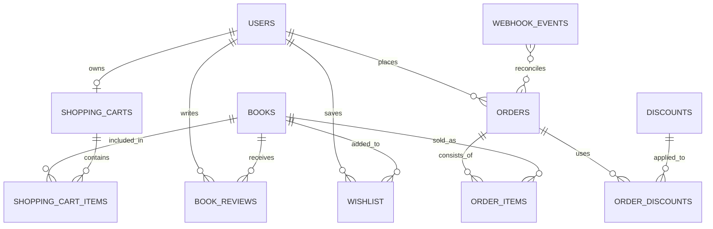

# Online Bookstore Engine

## Overview

### Application Overview

Books4You is a full-stack online bookstore prototype for readers who want to discover, compare, review, save, and purchase books. It combines a searchable catalog and book-detail pages with customer accounts, reviews, wishlists and share links, a shopping cart, and a Stripe card-checkout flow. Its business value is an end-to-end storefront foundation connecting product discovery and reader feedback to payment, order records, and customer order views.

This repository is an application project, not a claim that a fully operated retail service is production-ready. Running real commerce depends on verified Supabase schema/policies, secure production configuration, reliable Stripe webhook delivery and recovery, and the operational work listed in [Known Issues & Limitations](#known-issues--limitations).

## Project Status

**Status:** Feature-rich bookstore prototype; local tests, lint, and production build pass. Production commerce readiness remains conditional on the security, payment, database, and deployment work below.
**Audit snapshot:** October 23, 2026, local `master` at `bf2e178` with current uncommitted development-tools changes.
**Automated verification:** 243 Jest suites, 1,810 tests, and one snapshot passed; configured coverage is 100% across statements, branches, functions, and lines; ESLint and the production build passed.

### Verification Snapshot

| Check | Result |
| :--- | :--- |
| Jest suites | 243 passed / 243 total |
| Jest tests | 1,810 passed / 1,810 total |
| Snapshots | 1 passed / 1 total |
| Statements / branches / functions / lines | 100% each in the configured Jest collection |
| ESLint | Passed |
| Production build | Passed; TypeScript verification and route generation completed |
| Local Supabase integration suites | Passed on October 26, 2026: 10 tests across privacy, RPC permissions, and discount redemption |
| Live Stripe / browser E2E verification | Not run as part of this audit |

The coverage collection is defined in [jest.config.ts](jest.config.ts). It does not represent all deployment, infrastructure, excluded source, or external-service behavior. Unit/component tests primarily mock Supabase, Stripe, and framework boundaries; passing tests do not establish live payment or database correctness.

### Lighthouse Benchmark

Checked-in report artifacts (`lighthouse-desktop.report.html` / `.json` and `lighthouse-mobile.report.html` / `.json`) record the following scores. They were not regenerated during the October 23, 2026 audit.

#### Desktop

| Metric | Recorded score |
| :--- | :---: |
| Performance | 99 |
| Accessibility | 90 |
| Best Practices | 96 |
| SEO | 100 |

#### Mobile

| Metric | Recorded score |
| :--- | :---: |
| Performance | 71 |
| Accessibility | 90 |
| Best Practices | 96 |
| SEO | 100 |

Lighthouse scores are environment-sensitive snapshots, not WCAG conformance evidence. The recorded mobile performance score warrants a fresh measurement. Use `npm run build:audit` to rebuild and generate reports.

## Technology Stack

### Application

- **Next.js 16 App Router** for server-rendered routes, Server Actions, route handlers, and the `proxy.ts` request hook.
- **React 19** for interactive components, reducer/context state, and transition-based UI.
- **TypeScript** with generated Supabase database declarations and the `@/*` project alias.
- **Tailwind CSS 4** and **Material UI 9** for responsive layout, controls, and feedback.

### Backend and Persistence

- **Supabase Auth** and `@supabase/ssr` for email/password authentication and cookie-aware clients.
- **Supabase JavaScript client / PostgreSQL** for catalog, customer, cart, wishlist, review, order, discount, and webhook-event data.
- **Supabase Realtime** for user/cart synchronization.
- **Stripe** and Stripe Elements for PaymentIntent-based card checkout and webhook processing.
- **Upstash Redis** for shared sliding-window rate limits.
- **hCaptcha** token integration on authentication forms; effective enforcement depends on matching Supabase Auth CAPTCHA configuration.

### Supporting Libraries

- **Zod 4** for runtime validation.
- **Jest 30**, **jsdom**, and **React Testing Library 16** for unit/component testing.
- **ESLint 9** for linting.
- **Faker 10** for development seed data.
- **Notistack**, `use-debounce`, `react-intersection-observer`, and Vercel Analytics for notifications, interaction behavior, and analytics.

## Tech Stack & Architecture

The application follows a server-first Next.js App Router design. Server routes load catalog and account data; interactive client components support search, filtering, cart, wishlist, review forms, and payment entry. Mutations generally pass from the UI through Server Actions into domain services and repositories. Supabase/PostgreSQL is the persistence layer and Stripe handles card payment.

```text
Next.js routes / UI
   ├── Server-rendered reads
   └── Client interactions + reducer/context state
          │ Server Actions / route handlers
          ▼
     Zod validation → domain services → repositories
          ├── Supabase Auth / PostgreSQL / Realtime
          └── Stripe PaymentIntents / signed webhooks
```

Key implementation areas:

- [app/](app/) — route segments, pages, checkout, webhook, and reconciliation handlers.
- [components/](components/) — shared layout, catalog, cart, forms, filters, and UI.
- [data/](data/) — domain schemas, actions, services, repositories, and mappers.
- [providers/](providers/) — user/cart reducers and catalog/filter state.
- [hooks/](hooks/) — search and interaction hooks.
- [utils/](utils/) — Supabase clients, error/network helpers, rate limiting, audit logging, and seed utilities.
- [supabase/migrations/](supabase/migrations/) — five checked-in SQL migrations, including schema/RPC definitions, privacy/RPC permission updates, and atomic checkout discount redemption.
- [database.types.ts](database.types.ts) — generated TypeScript declarations; this file complements but does not replace executable SQL migrations.

### Backend and Database Configuration Caveat

The repository contains migrations for the captured schema and subsequent privacy and commerce-RPC permission changes. The application source cannot establish whether a deployed Supabase project has applied these migrations or matches the local migration history. Apply and verify migrations in a disposable database and compare deployment migration state before relying on policies, grants, or RPC behavior in production.

## Implemented Features

### Catalog and Book Discovery

- Server-rendered homepage catalog and bestseller content.
- Book detail route at `/book/[slug]`, including metadata, price/stock information, reviews, and related-book content.
- Sorting, filtering, pagination, and explicit loading/error/empty states.
- Configured image optimization for AVIF/WebP.
- Relevant code: [app/page.tsx](app/page.tsx), [app/book/](app/book/), [data/books/](data/books/), [data/advancedFiltering/](data/advancedFiltering/).

### Search

- Debounced, case-insensitive partial title search.
- Keyboard navigation, bounded suggestions, loading/error feedback, and cancellation of obsolete requests.
- Relevant code: [components/layout/UserNavbar/SearchBar/](components/layout/UserNavbar/SearchBar/), [hooks/SearchBar/](hooks/SearchBar/).

### Reviews

- Paginated book reviews and ratings.
- Authenticated review submission with profile-completion requirements.
- User review management with edit/delete actions and ownership checks.
- Public review visibility follows user settings and database policy behavior.
- Relevant code: [app/book/[slug]/components/Reviews/](app/book/[slug]/components/Reviews/), [app/user/reviews/](app/user/reviews/), [data/books/reviews/](data/books/reviews/).

### Authentication and Onboarding

- Supabase email/password signup, sign-in, and password change.
- CAPTCHA token integration, runtime input validation, and security-audit events.
- Server-aware session loading and client auth-state synchronization.
- Profile onboarding for identity and customer details such as address, date of birth, phone, and username.
- Relevant code: [app/user/auth/](app/user/auth/), [app/user/profile/](app/user/profile/), [data/auth/](data/auth/), [data/user/onboarding/](data/user/onboarding/).

### User Profiles and Public Identity

- Private profile and address management.
- Public profile route at `/user/profile/public/[username]`.
- Separate profile, review, and wishlist visibility controls.
- See [Privacy Model and Data Exposure](#privacy-model-and-data-exposure) for what public routes expose and how bearer share links behave.
- Relevant code: [app/user/profile/](app/user/profile/), [data/user/profile/](data/user/profile/).

### Shopping Cart

- Authenticated cart creation and add/update/remove/clear operations.
- Quantity controls, summary/sidebar, optimistic feedback, and Supabase state refresh.
- Reducer/context-backed client state seeded from server data.
- Relevant code: [data/cart/](data/cart/), [providers/cart/](providers/cart/), [components/CartSidebar/](components/CartSidebar/), [components/CartForms/](components/CartForms/).

#### Checkout Boundary

Checkout at `/checkout` accepts shipping/address information, a discount selection, a shipping method, and card payment details. The server validates the payload, resolves the signed-in user, reads that user's cart, reloads product prices/availability, and creates the order through a database RPC. Stripe PaymentIntents are handled server-side; the webhook at `/api/webhooks/stripe` verifies signatures and invokes a database transaction for order/payment state. The cart is cleared in the successful-payment database flow rather than immediately when the order is first created.

`/checkout/success`, `/user/orders`, and `/user/order/[orderId]` provide confirmation and order history/detail views. A cron reconciliation route handles stale pending orders and unmatched webhook events. These mechanisms are implemented in source but require database/Stripe integration and failure-path verification before production reliance.

Discount dates, active status, minimum spend, and global/per-user usage limits are revalidated atomically when the order transaction attaches a discount. Reservations are released when pending orders fail or are cancelled. A local Supabase integration suite covers date/minimum checks, usage release, and concurrent global limits; it must be run separately. Remaining limitations include card-only payment UI, zero default tax, and UK postcode-based shipping. See [Known Issues & Limitations](#known-issues--limitations).

### Wishlist and Sharing

- Authenticated add/remove wishlist operations and a private wishlist page.
- Username-addressed public sharing and private token-addressed sharing.
- Visibility/share controls, token regeneration, and restricted/unavailable states.
- Private wishlist share tokens act as bearer links: anyone holding the active token can access the shared list.
- Relevant code: [app/user/wishlist/](app/user/wishlist/), [data/user/wishlist/](data/user/wishlist/).

### Navigation and Information Pages

- Shared header/footer, search, profile/auth actions, cart entry point, breadcrumbs, and responsive catalog controls.
- Privacy, return, shipping, and terms routes under `/infos/`.
- Relevant code: [components/layout/](components/layout/), [app/infos/](app/infos/).

### Development Console and Seed Data

- `/dev-tools` provides development seed/reset controls and tooling for local data inspection.
- Faker-based generators support books, users, reviews, carts, wishlists, orders, and discounts.
- These tools use service-role access to populate, extend, and reset the personal project's development database. The page and all exported server actions are restricted to development mode. Keep the local server private and use a development database, because reset operations are destructive.
- Relevant code: [app/dev-tools/](app/dev-tools/), [utils/db/dbSeed/](utils/db/dbSeed/).

## Architecture

### Server-First Rendering with Interactive Islands

Catalog and route-level reads generally stay on the server. Client components provide browser interaction for search, filtering, cart, review forms, sharing controls, and Stripe Elements. This keeps interactive state localized while retaining server-rendered content.

### Provider Composition

[components/layout/SessionProviderWrapper.tsx](components/layout/SessionProviderWrapper.tsx) resolves session-linked state and seeds the provider tree. [providers/Providers.tsx](providers/Providers.tsx) composes filtering, sort, user, cart, and notification providers. User/cart providers use reducers and separate state/action contexts; Realtime listeners refresh authoritative state.

### Dual Context + Reducer Pattern

Cart and user transitions are centralized in [providers/cart/CartReducer.ts](providers/cart/CartReducer.ts) and [providers/user/UserReducer.ts](providers/user/UserReducer.ts). Separate state/action contexts let mutation-only consumers avoid subscribing to every state update. This is a client-state optimization, not a replacement for server authorization or database consistency.

### Server-Seeded Initial State

The server loads initial authenticated state before rendering the provider tree, reducing empty-cart or anonymous-state flashes after hydration. Browser listeners handle later authentication and database changes.

### Service and Repository Boundaries

Domain code generally separates request parsing, business orchestration, database access, and row-to-view mapping. Checkout re-reads product prices and availability on the server. [data/checkout/services/CheckoutServiceUtils.ts](data/checkout/services/CheckoutServiceUtils.ts) contains the extracted checkout operations for loading products and discounts, calculating totals, building/persisting order payloads, and handling PaymentIntent recovery. Final discount reservation is enforced by the database migration during order creation.

### Schema-First Validation

Zod schemas cover authentication, onboarding, cart, review, wishlist, and checkout input. Checkout validates its payload at the action boundary and derives product IDs/quantities from the signed-in user's database cart. Runtime-parse external and database RPC responses as needed; TypeScript declarations alone do not validate runtime data.

### Real-Time Synchronization

Supabase Realtime listeners in user/cart providers refresh authoritative data. This limits reliance on stale optimistic assumptions but can multiply database reads under high event volume; event coalescing and operational metrics are recommended before scaling.

## Data Model

Generated type declarations describe users, books, reviews, carts/cart items, wishlist, orders/order items, discounts, order discounts, addresses, and webhook events. The migrations define the checked-in SQL schema and functions, including order creation and Stripe event processing.



The diagram is a high-level application view, not a substitute for reviewing migration DDL, constraints, indexes, RLS policies, and function grants in the target database.

## Usability and Interaction Design

- Search suggestions are bounded and keyboard-operable.
- Forms provide validation, pending, success, and error feedback.
- Cart and wishlist controls provide interaction feedback.
- Loading skeletons, empty states, restricted/unavailable states, and error components are shared across routes.
- MUI and Tailwind support responsive forms, drawers, navigation, and catalog layouts.
- Checkout currently has a card-only payment interface; the schema's alternative payment enum is not a complete payment implementation.

## Accessibility Posture

The UI includes semantic route headings, form controls, keyboard behavior for search, focusable actions, responsive layouts, and explicit error states. Existing Lighthouse artifacts show accessibility 90 for desktop and mobile, but there is no complete WCAG audit or automated axe suite configured.

Before release, audit accessible names/state for icon controls and search, focus behavior in dialogs/drawers, keyboard navigation, validation/error announcements, heading structure, contrast, reduced motion, and mobile zoom/reflow. Add automated axe checks and conduct manual keyboard and screen-reader testing. Regenerate the Lighthouse reports against the production build; the existing mobile performance score is 71.

## Security and Data Protection

### Authentication and Authorization

- Supabase browser, SSR, and admin clients are separate; admin/service-role access bypasses RLS and must remain server-only.
- `proxy.ts` handles sessions on selected private routes. It is not a substitute for action-level authentication/authorization.
- Many domain mutations resolve the current actor and apply ownership rules; order details check ownership.
- Stripe webhook requests verify their signature before processing.
- The `/dev-tools` route and all its server actions are restricted to `NODE_ENV=development` and are unavailable otherwise, including production builds and test environments. The tools use service-role privileges to seed and reset development data; run them only against the intended development project and do not expose the development server to untrusted users or networks.

### Privacy Model and Data Exposure

Privacy controls are independent for the profile, reviews, and wishlist:

- A private profile page can still indicate the username and private status but does not expose profile sections there.
- Review and username-addressed wishlist visibility are independent. A public review or wishlist may be reached through its own route even if the profile is private; the profile page displays a section only when both the profile and that section are public.
- Public profile data exposes the username and, when enabled, join month/year.
- Public reviews expose review/book identifiers, username, rating, review text, timestamps, and book title/author.
- Public wishlist entries expose username and book/catalog display data such as book ID, title, author, price, image URL, and description.
- Private address, contact details, date of birth, phone number, and wishlist share token are not intended public fields.
- A private wishlist share token is a bearer secret. Anyone holding the current token can view the shared list; rotating or revoking it must invalidate prior access.

The profile RPC is restricted to `service_role` by migration; review visibility is enforced by RLS and privacy settings; wishlist access is constrained by public visibility or a matching share token. Verify the deployed migration state and access behavior before treating these rules as production guarantees. Social feeds, messaging, and other community features are not implemented and should not be added until this privacy/data-exposure contract is explicitly reviewed and tested.

### Input and Error Safety

Zod validation and shared Supabase error utilities are used across important boundaries. Checkout validates request data, obtains line items from the authenticated user's server-side cart, and re-reads product data. The order transaction atomically validates and reserves discount usage; client-visible discount preview is not a final authorization decision. Client responses should remain sanitized while server-side diagnostics preserve enough context for safe operations.

### Response Security

[next.config.ts](next.config.ts) configures CSP, HSTS, frame/content-type protections, referrer policy, permissions policy, compression, image hosts, and disabled powered-by headers. CSP currently includes `'unsafe-inline'` and `'unsafe-eval'`; evaluate a nonce/hash strategy compatible with Next.js, MUI, and Stripe before tightening it.

### Security Gaps

- Development seed/reset actions are destructive and use service-role privileges. The app-mode guard prevents access outside development, but operators must also ensure the configured Supabase project is the intended development database.
- Reconciliation does not check the result of deleting an unmatched webhook event before replaying it.
- IP rate limiting trusts edge-provided client-IP headers. The production proxy must overwrite them and prevent direct-origin access.
- Verify deployed RLS policies and the service-role-only commerce RPC grants against the committed migrations.
- There is no complete durable audit delivery, structured error reporting, or alerting stack.

## Testing and Quality Assurance

### Test Organization

Tests in [__tests__/](__tests__/) cover app/components, domain actions/services/repositories/schemas, hooks, providers/reducers, and utilities. Framework and external-service mocks are in [__mocks__/](__mocks__/). The standard Jest suite excludes opt-in database integration tests.

The local Supabase integration suites cover privacy behavior, commerce RPC role permissions, and checkout discount redemption. They require a running local Supabase stack and loopback endpoint; commands are `npm run test:db:privacy`, `npm run test:db:rpc-security`, and `npm run test:db:discount-redemption`. On October 26, 2026, all three suites passed locally (4 privacy tests, 2 RPC-permission tests, and 4 discount-redemption tests). The local migration history lists all five checked-in migrations as applied. This verifies the local Supabase environment only; deployed database migration state and policies were not inspected. There is no configured browser E2E suite, and mocks do not establish live Stripe delivery or deployed database correctness.

### Current Coverage

The October 23, 2026 Jest run passed **243 suites, 1,810 tests, and one snapshot**. Its configured V8 report showed **100% statements, branches, functions, and lines** for files included by [jest.config.ts](jest.config.ts).

The percentage excludes source and behavior outside the configured collection. It does not cover all route/deployment boundaries, CSS, live Supabase/Stripe interactions, environment configuration, or customer journeys in a browser. Coverage is a regression measure, not proof of system correctness.

### Verification Commands

```powershell
# Install exact locked dependencies
npm ci

# Start the development server
npm run dev

# Run Jest and collect configured coverage
npm run test

# Run lint and production build/type verification
npm run lint
npm run build

# Start the production server after a successful build
npm start

# Run Jest in watch mode
npm run test:watch

# Check dependency audit/signatures (network access may be required)
npm run secure-check
npm run safe-install
```

For database integration tests, start/reset the local Supabase project and use only local credentials:

```powershell
npx supabase start
npx supabase db reset
npx supabase status -o env

# Set these from local Supabase output; use API_URL, not REST_URL or DB_URL.
$env:SUPABASE_INTEGRATION_URL = "http://127.0.0.1:54321"
$env:SUPABASE_INTEGRATION_ANON_KEY = "<local anon key>"
$env:SUPABASE_INTEGRATION_SERVICE_KEY = "<local service-role key>"

npm run test:db:privacy
npm run test:db:rpc-security
npm run test:db:discount-redemption
```

The integration suites are restricted to loopback URLs and clean up their own fixtures. Do not point them at production or a customer database.

To regenerate Lighthouse reports after building:

```powershell
npm run build:audit
```

The optional database-type refresh script reads `.env` and requires `NEXT_PUBLIC_SUPABASE_PROJECT_ID`; review the target project carefully because generated output comes from that remote schema:

```powershell
npm run db:types-refresh
```

### Build and Route Verification

`npm run build` passed on October 23, 2026. The build completed TypeScript verification and generated these routes:

```text
/
/_not-found
/api/cron/reconcile
/api/webhooks/stripe
/book/[slug]
/checkout
/checkout/success
/dev-tools
/infos/privacypolicy
/infos/returnpolicy
/infos/shippinginfo
/infos/tos
/user/auth/change_password
/user/auth/signin
/user/auth/signup
/user/order/[orderId]
/user/orders
/user/profile
/user/profile/change_address
/user/profile/public/[username]
/user/reviews/[username]
/user/wishlist
/user/wishlist/[username]
/user/wishlist/token/[token]
```

The build reports these routes as dynamically rendered. Route generation does not verify database availability, authorization correctness, or payment delivery.

### Directory Structure

```text
app/                  App Router pages, route handlers, checkout and account flows
components/           Shared storefront, catalog, layout, cart, forms and UI
data/                 Domain schemas, actions, services, repositories and mappers
providers/             User/cart reducers and catalog state providers
hooks/                 Search and interaction hooks
utils/                 Supabase clients, errors, network helpers, audit and seed utilities
supabase/migrations/   Four checked-in schema, privacy and RPC-permission migrations
__tests__/             Jest app, component, data, hook, provider and utility tests
__tests__/integration/ Opt-in local Supabase integration tests
__mocks__/             Framework/external dependency mocks
public/                Static assets
database.types.ts      Generated Supabase type declarations
jest.config.ts         Jest and coverage configuration
next.config.ts         Next.js image, compression and security-header configuration
proxy.ts               Selected route session handling
package.json           Scripts and dependency declarations
```

## Getting Started

### Prerequisites

- Node.js compatible with the project lockfile and npm; the current GitHub Actions workflow uses Node.js 25.
- A Supabase project with the checked-in migrations applied for application data, authentication, policies, and RPCs. A local development project can be run with the Supabase CLI.
- Stripe test-mode publishable/secret keys and a webhook signing secret to exercise checkout.
- Upstash Redis REST credentials for shared rate limiting. Sensitive operations fail closed when required rate-limit configuration is unavailable.
- hCaptcha site key and matching CAPTCHA configuration in Supabase Auth for signup/sign-in.

### Install Dependencies

```powershell
npm ci
```

### Configure Environment Variables

Create `.env.local` in the repository root. Environment files are ignored by Git; never commit real credentials. This repository does not currently include a `.env.example`.

```dotenv
NEXT_PUBLIC_SUPABASE_DB_URL=https://<project-ref>.supabase.co
DEV_TOOLS_ALLOWED_SUPABASE_URL=https://<intended-development-project-ref>.supabase.co
NEXT_PUBLIC_SUPABASE_PUBLIC_KEY=<supabase-publishable-or-anon-key>
SUPABASE_SECRET_KEY=<server-only-supabase-secret-key>

UPSTASH_REDIS_REST_URL=https://<redis-database>.upstash.io
UPSTASH_REDIS_REST_TOKEN=<server-only-upstash-rest-token>

NEXT_PUBLIC_STRIPE_PUBLISHABLE_KEY=pk_test_<value>
STRIPE_SECRET_KEY=sk_test_<value>
STRIPE_WEBHOOK_SECRET=whsec_<value>

CRON_SECRET=<server-only-cron-secret>
NEXT_PUBLIC_HCAPTCHA_SITE_KEY=<hcaptcha-site-key>
```

`SUPABASE_SECRET_KEY`, `UPSTASH_REDIS_REST_TOKEN`, `STRIPE_SECRET_KEY`, `STRIPE_WEBHOOK_SECRET`, and `CRON_SECRET` are server-only secrets. Never prefix them with `NEXT_PUBLIC_` or expose them to the browser. The Supabase public key and Stripe publishable key are intended for browser use. Configure the matching hCaptcha secret in the Supabase Auth dashboard; application code consumes the site key/token.

The reconciliation endpoint requires `CRON_SECRET`; configure the scheduler to send the matching authorization header. IP-based limiting reads edge-provided headers such as `cf-connecting-ip` or `x-real-ip`. Production must ensure the trusted edge overwrites these headers and that the origin cannot be reached directly by untrusted clients.

`DEV_TOOLS_ALLOWED_SUPABASE_URL` is a server-only safety allowlist for destructive `/dev-tools` actions. Set it to the exact API origin of the intended development Supabase project; actions are blocked unless it matches `NEXT_PUBLIC_SUPABASE_DB_URL`. Do not point it at production or a customer database.

The optional type-refresh script additionally requires `NEXT_PUBLIC_SUPABASE_PROJECT_ID` in `.env`. It generates types from the configured remote Supabase project, so confirm the target before running it.

### Start Development

1. Start a local Supabase project or provision a development Supabase project.
2. Apply the checked-in migrations to that development database and confirm the configured Auth/CAPTCHA behavior.
3. Add the required local environment variables.
4. Start Next.js:

   ```powershell
   npm run dev
   ```

5. Open `http://localhost:3000`.
6. For local Stripe webhook testing, install the Stripe CLI separately and forward events to `http://localhost:3000/api/webhooks/stripe`; set its generated signing secret as `STRIPE_WEBHOOK_SECRET`.

Seed/reset tools use service-role access and may delete or replace database data. They fail closed unless `DEV_TOOLS_ALLOWED_SUPABASE_URL` matches the configured Supabase URL. Run them only against a disposable development project, never production or a customer database.

### Production Verification

```powershell
npm run lint
npm run test
npm run build
```

Before enabling live payments, also verify migration history and RLS in the target project, keep the `/dev-tools` runtime guard in place, test discount redemption and payment/webhook retries against a disposable database and Stripe test account, and confirm tax/shipping rules. Passing the commands above alone is not production certification.

## Known Limitations

See [Known Issues & Limitations](#known-issues--limitations) and [Future Roadmap](#future-roadmap) for current risks and planned work.

## Known Issues & Limitations

### Commerce Completion

1. **Reconciliation deletion failure:** [app/api/cron/reconcile/route.ts](app/api/cron/reconcile/route.ts) does not inspect the result of deleting an unmatched webhook event before attempting replay. Recovery could be reported as successful when the prior event remains and the RPC treats it as a duplicate.
3. **Tax and shipping scope:** tax defaults to zero, and shipping methods/prices use UK postcode zones; confirm applicable business, tax, and fulfillment requirements.
4. **Payment scope:** the UI supports Stripe card payment only. Alternative payment methods are not implemented as complete server-validated flows.
5. **Cross-system recovery:** Stripe and Supabase do not share a transaction. Checkout now attempts to recover an order after an ambiguous RPC result and cancel an orphaned PaymentIntent when no order exists, but partial failures, deployment configuration, and all retry paths still require integration testing and operational alerting.

### Discounts and Promotions

Discount preview is informational; final order creation is authoritative. The `20261022130000_enforce_checkout_discount_redemptions.sql` migration adds a database trigger that validates active status, date window, minimum subtotal, global usage, and per-user usage while the order transaction inserts its discount relation. It increments usage atomically and releases the reservation when an order transitions from pending to failed/cancelled. A focused local Supabase integration suite covers date/minimum rejection, global/per-user limits, release behavior, and concurrent reservation. Apply the migration in each environment and run the integration suite before relying on the workflow in production.

### Administration and Operations

`/dev-tools` is a personal-project development console for seeding books, reviews, carts, wishlists, orders, and discounts, adding generated data, and resetting the database. The page returns not found outside `NODE_ENV=development`, and all exported server actions independently enforce the same runtime guard before privileged work. Its seed/reset operations use the service role and can destroy data; keep the server private and verify that the configured Supabase project is the development database before running them.

There is no reviewed production RBAC/admin console. The reconciliation route also requires a correctly configured cron secret and monitored scheduler.

### Public Identity

Public profile, review, and wishlist routes follow the [Privacy Model and Data Exposure](#privacy-model-and-data-exposure). Their visibility settings are independent; a private profile does not by itself revoke a public review, public username wishlist, or existing private wishlist bearer link. No social feed, messaging, or moderation workflow is implemented.

### Security, Accessibility, and Observability

- Production rate limits depend on correctly configured Upstash credentials and trusted proxy headers; prevent direct-origin access and header spoofing.
- Confirm deployed Supabase migrations, RLS policies, and service-role-only RPC permissions before relying on them.
- CSP includes `'unsafe-inline'` and `'unsafe-eval'`; assess nonce/hash hardening alongside Next.js/MUI/Stripe compatibility.
- No full WCAG audit, automated axe suite, or browser E2E suite is configured.
- Existing Lighthouse artifacts record mobile performance 71 and accessibility 90; the artifacts are not current audit runs or accessibility certification.
- CI currently runs Jest only; lint, production build/type checks, migrations, and integration/E2E tests are not required gates.
- Audit/security logging is not a complete structured observability, durable delivery, and alerting system.
- No checked-in `.env.example` or complete deployment-specific environment validation is provided.

## Roadmap

### Future Roadmap

The roadmap lists remaining work based on the audited local checkout; implemented features are documented above.

### 1. Checkout and Commerce Completion

- [x] Check and handle webhook-event deletion failures before reconciliation replay; the route reports deletion errors and skips replay for that event.
- [ ] Run the discount redemption integration suite and verify migration application in disposable and production-like Supabase environments.
- [ ] Test payment/webhook failure and retry flows against disposable Supabase and Stripe test environments.
- [ ] Confirm tax calculation, shipping coverage/pricing, cancellation, refund, and order-state requirements.
- [ ] Add alternative payment methods only as complete server-validated and recoverable flows.

### 2. Public Profiles and Community Features

- [ ] Keep the exposure contract documented and test it at SQL/RLS and route boundaries as features evolve.
- [ ] Consider social/community features only after privacy rules, data exposure, moderation, and user controls are explicitly designed and documented.

### 3. Store Operations

- [ ] Build a protected production administration surface separate from `/dev-tools`.
- [ ] Add server-enforced roles/claims and caller authorization for every privileged operation.
- [ ] Add inventory, order, and discount administration with auditable changes.
- [ ] Add review moderation and audit-log browsing.
- [ ] Add sales analytics and controlled bulk catalog/customer operations.
- [x] Require an explicit `DEV_TOOLS_ALLOWED_SUPABASE_URL` match before destructive seed/reset operations.

- [ ] Make all development seeding and generated-data commands collision-aware, capacity-bounded, and safe to retry:
  **Current failure evidence:** [generateBook.ts](utils/db/dbSeed/generateBook.ts) checks title duplicates only within the generated array, does not compare with stored books, and has an unbounded loop while filling the requested count. [generateReview.ts](utils/db/dbSeed/generateReview.ts) avoids duplicate `(book_id, user_id)` pairs only within one call, while the database enforces `one_review_per_user_per_book`; [DevToolsService.ts](app/dev-tools/actions/DevToolsService.ts) generates and inserts 50 books/reviews without loading their existing natural keys. Audit the other generators and insert paths as part of this task.

  **Rate-limit requirement:** `/dev-tools` is currently limited to 10 privileged actions per hour. Treat one user-initiated command as one rate-limited write operation: candidate generation, deduplication, capacity calculation, preflight reads, and internal batches/retries must not consume additional rate-limit hits. Perform the check at most once per command, immediately before beginning its database writes; reject invalid commands, invalid target configuration, and preflight failures before consuming a write allowance. Do not weaken fail-closed behavior or allow internal loops to call the limiter repeatedly.
  - [ ] Inventory every generator and write path used by full reset and individual commands (`generateBook(s)`, reviews, users, discounts, orders/items, carts/cart items, wishlists); document database unique constraints and each entity's natural/business key.
  - [ ] Define canonical comparison rules before generating candidates: books by normalized title plus author (case/whitespace-insensitive); reviews by `(user_id, book_id)`; discounts by normalized code; users by normalized email and username; cart/wishlist/order relations by their actual constrained foreign-key pairs.
  - [ ] Fetch only the existing keys needed for a command, merge them with keys reserved in the current batch, and reject candidates that collide with either set. Do not rely on Faker randomness, UUIDs alone, or a database exception as the normal deduplication strategy.
  - [ ] Replace retry-until-count loops with bounded candidate generation. Calculate remaining capacity for constrained pairs (especially reviewable user/book combinations) and return an explicit result when the requested count cannot be met; never loop indefinitely or silently return fewer records as success.
  - [ ] Make requested count semantics explicit: add exactly the requested number of new unique records or fail before writing, unless the UI explicitly offers a partial-count mode and reports requested/available/created counts.
  - [ ] Preflight complete related batches before inserts: validate references, uniqueness within/across tables, order item composition, discount eligibility/capacity, and generated user identities. Keep generated relationships consistent with the users/books actually present rather than fixed fixture IDs.
  - [ ] Define partial-failure and retry behavior for multi-table generation. Prefer transactional persistence for a generation batch where practical; otherwise track completed stages, surface partial results, and make retry safe without duplicating records.
  - [ ] Preserve the 10-per-hour privileged-action limit without charging for generation loops: one limiter check at most per user-requested command, after non-mutating validation/preflight and immediately before writes. Ensure no per-row/per-batch/per-retry checks; test that preflight-only/invalid requests do not consume a write allowance and actual write attempts are limited exactly once.
  - [ ] Return actionable outcomes to the dev-tools UI (inserted count, skipped collisions if intentionally supported, exhausted capacity, and failed stage); do not report success after unchecked insert errors or ignored `Promise.all` results.
  - [ ] Add deterministic unit tests for canonical-key collisions, existing-database collisions, batch-internal duplicates, capacity exhaustion, exact-count behavior, concurrent/repeated generation, and each command's error reporting.
  - [ ] Add local Supabase integration tests that invoke the real generation commands twice and verify no unique-constraint errors, no duplicate natural keys, correct inserted counts, preserved pre-existing rows, and cleanup of test fixtures.
  - [ ] Keep full reset semantics separate from additive generation: reset may clear only the explicitly allowlisted development database; add commands must never clear or overwrite existing user-created data.
- [ ] Add structured logs, metrics, traces, alerts, and durable security audit delivery.

### 4. Experience and Accessibility

- [ ] Run a complete WCAG 2.2 AA assessment (including manual keyboard and assistive-technology checks).
- [ ] Review accessible names, roles, state announcements, and focus management across main flows.
- [ ] Test dialogs, drawers, checkout, forms, search, and filters using keyboard-only interaction.
- [ ] Add automated axe checks for key customer journeys.
- [ ] Regenerate comparable mobile/desktop reports and improve the mobile performance baseline.
- [ ] Verify contrast, visible focus, reduced motion, zoom, and responsive reflow.

### 5. Security and Reliability

- [x] Restrict `/dev-tools` and every exported server action to development mode; other environments return not found or reject the action.
- [ ] Verify the deployment has applied and tested the committed migrations and RLS policies.
- [ ] Verify trusted-proxy/client-IP configuration and prevent direct-origin access.
- [ ] Check cron authorization, scheduler delivery, and reconciliation alerts in deployment.
- [ ] Harden CSP with a compatible nonce/hash strategy where feasible.
- [X] Extend CI with lint, TypeScript/build, migrations, database integration, and E2E gates.
- [ ] Add dependency/security checks and secret scanning to release workflows.
- [ ] Add environment validation and a safe `.env.example` template.
- [ ] Replace unvalidated RPC/external payload assumptions with runtime validation.
- [ ] Make retry logic explicit for transient failures and idempotent operations.
- [ ] Add observable, durable audit delivery and structured operational telemetry.
- [ ] Measure query, Realtime, and application behavior under representative load.

## 6. Profile

- [ ] Verify cancellation/refund and inventory behavior under real database/payment integration tests.

This repository is a personal engineering project demonstrating a full-stack bookstore. It does not provide a support contact, service-level commitment, or production operations team. Do not treat the demo as an operated retail service without the deployment, security, legal, and payment work listed above.

## Engineering Decisions and Tradeoffs

### Why Supabase

Supabase supplies PostgreSQL, Auth, SSR-friendly session integration, and Realtime with a small operational footprint. The tradeoff is a requirement for explicit RLS, well-scoped service-role usage, and reviewed migrations that are applied consistently to every environment.

### Why Server Actions

Server Actions reduce custom mutation API boilerplate and integrate with App Router forms and transitions. They are callable server endpoints: every exported action must validate untrusted input, authenticate the caller, authorize the requested resource, and apply abuse controls independently of whether its UI route is visible.

### Why Reducers Instead of Scattered Local State

Cart and user state have multi-step transitions and asynchronous refresh paths. Reducers provide explicit, unit-testable transitions; ephemeral input state remains local to pages/components.

### Why Separate State and Action Contexts

Separating state from actions lets mutation-only consumers avoid rerenders tied to unrelated state changes. Keep this pattern where profiling supports it and avoid creating duplicated sources of server state.

### Why Seeded Development Data

Faker-generated related data supports UI development and test setup. Full reset and service-role seed utilities are destructive and must remain restricted to disposable development environments.

## Conclusion

The checked-out repository provides a broad bookstore prototype with domain-oriented code, five committed database migrations, database-backed webhook idempotency, atomic discount reservation, and comprehensive configured Jest coverage. The October 23, 2026 local Jest (243 suites and 1,810 tests), lint, and production-build checks passed with the current uncommitted development-tools changes. These results do not verify the opt-in database suites, a deployed Supabase project's migration/RLS state, or live Stripe behavior.

Before production commerce, address reconciliation error handling. Then validate migrations, RLS, proxy trust, cron delivery, payment recovery, tax/shipping behavior, and accessibility in production-like environments. The personal-project dev console remains development-only, service-role privileged, and destructive by design. This assessment describes the current local changes based on commit `bf2e178`.
